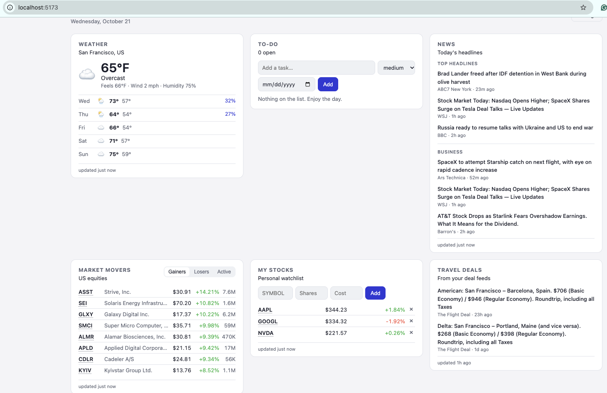
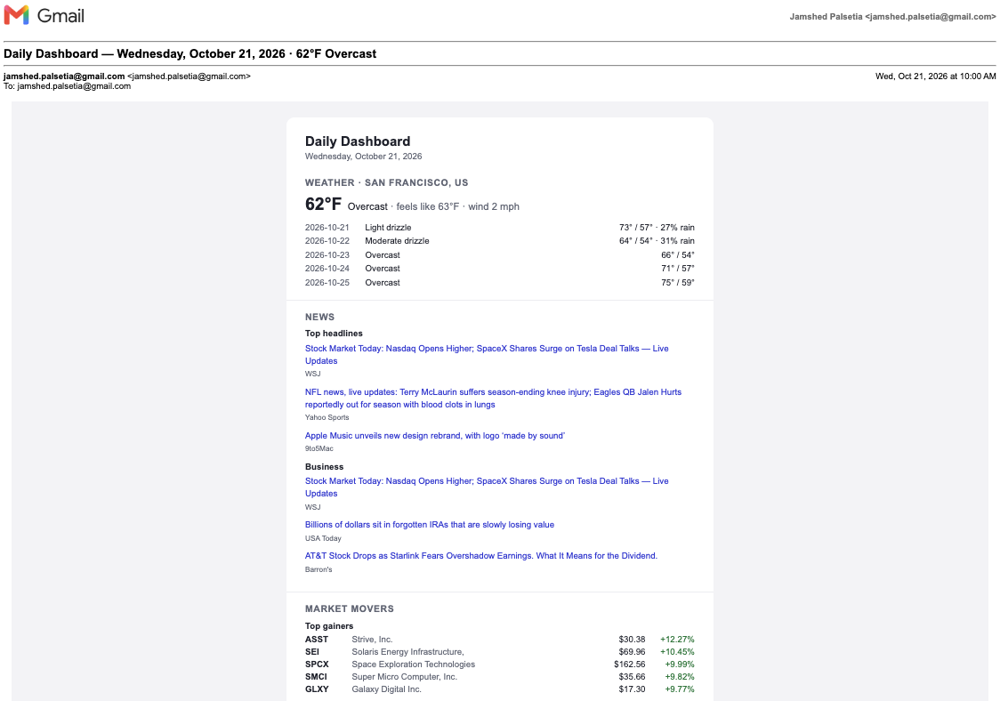
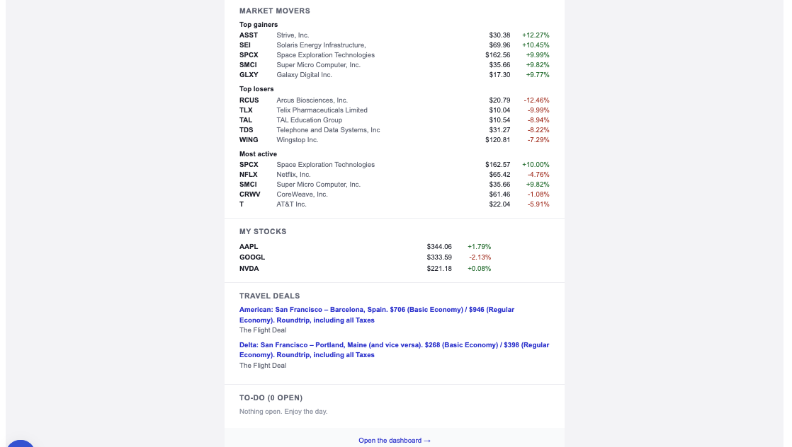

# Daily Dashboard

A single-user daily dashboard with five widgets and a once-a-day email digest.

> **Built with AI:** Built in two evenings using Claude and Cursor, compared with an estimated three to four weeks without AI assistance. AI accelerated scaffolding, integrations, and debugging; design decisions such as caching, failure handling, and deployment were mine.

## Screenshots

**Dashboard**


**Daily email digest**
*Top: weather, news, market movers*


*Bottom: market movers (continued), my stocks, travel deals, and to-dos*


## Widgets

- **Weather** — current conditions and a 5-day forecast (Open-Meteo)
- **Market movers** — top gainers, losers, and most-active US equities (Yahoo Finance via `yfinance`)
- **My stocks** — personal watchlist with optional shares/cost basis, stored in Postgres
- **News** — 3 top headlines and 3 business headlines (Google News RSS)
- **Travel deals** — headlines aggregated from RSS deal feeds
- **To-do** — priority and due date, stored in Postgres; completed items disappear three days after you check them

Every data source is keyless. The only credentials you need are SMTP details for the email.

## Stack

FastAPI + SQLAlchemy + Postgres on the backend, React + Vite + TanStack Query on the frontend, APScheduler for the daily email, all under Docker Compose.

## Running locally

Docker is the only prerequisite — Python and Node run inside containers.

```bash
cp .env.example .env     # then edit it, see below
docker compose up --build
```

If your shell reports `docker: command not found` even though Docker Desktop is
running, it never created the `/usr/local/bin` symlinks. Add its bundled CLI to
your PATH:

```bash
echo 'export PATH="/Applications/Docker.app/Contents/Resources/bin:$PATH"' >> ~/.zshrc
source ~/.zshrc
```

- Dashboard: http://localhost:5173
- API docs: http://localhost:8080/docs
- Health: http://localhost:8080/api/health

The first start builds the API image, runs migrations, and installs frontend dependencies, so give it a couple of minutes.

### Configuring the email

Put SMTP credentials in `.env`. For Gmail you must use an [App Password](https://support.google.com/accounts/answer/185833), not your account password:

```
SMTP_HOST=smtp.gmail.com
SMTP_PORT=587
SMTP_USER=you@gmail.com
SMTP_PASSWORD=your-16-char-app-password
SMTP_FROM=you@gmail.com
```

Then open **Settings** in the dashboard to set the recipient address and the send time, and hit **Send test email** to confirm it works. **Preview** renders the same email in a browser tab without sending it.

### Everything else is configured in the UI

Location (with city search), units, timezone, digest time, RSS feed list, and an optional keyword filter for deals all live in the database and are editable from the Settings drawer. Schedule changes take effect immediately — no restart.

## Deploying to the Ubuntu server

```bash
# on the server
git clone <your-repo> daily-dashboard && cd daily-dashboard
cp .env.example .env    # set a real POSTGRES_PASSWORD, SMTP creds, TZ,
                        # and DASHBOARD_URL=http://your-server:8080
docker compose -f docker-compose.prod.yml up -d --build
```

The production stack builds the frontend to static files and serves them from nginx, which also proxies `/api` to the API container — the browser only ever talks to port 8080, so there is no CORS to configure. Postgres is not published to the host. Change the published port with `WEB_PORT` in `.env`.

Useful operations:

```bash
docker compose -f docker-compose.prod.yml logs -f api
docker compose -f docker-compose.prod.yml exec db pg_dump -U dashboard dashboard > backup.sql
docker compose -f docker-compose.prod.yml up -d --build   # deploy an update
```

Migrations run automatically on every API start.

## API

| Method | Path | Purpose |
| --- | --- | --- |
| GET | `/api/weather` | Current conditions + forecast |
| GET | `/api/weather/geocode?q=` | City search for the settings panel |
| GET | `/api/stocks/movers` | Gainers / losers / most active |
| GET | `/api/stocks/watchlist` | Watchlist with live quotes and totals |
| POST/PATCH/DELETE | `/api/stocks/watchlist` | Manage watchlist entries |
| GET | `/api/news` | Top and business headlines |
| GET | `/api/travel/deals` | Aggregated RSS deals |
| GET/POST/PATCH/DELETE | `/api/todos` | To-do CRUD |
| GET/PATCH | `/api/settings` | Read and update preferences |
| GET | `/api/digest/preview` | Render the email in the browser |
| POST | `/api/digest/send-now` | Send the digest immediately |
| GET | `/api/digest/status` | SMTP status and recent send log |

## How failures are handled

Every upstream call is wrapped in a `cache_entry` row with a TTL (weather 30 min, movers 10 min, quotes 5 min, news 20 min, deals 3 hours). If a refresh fails but cached data exists, the stale copy is served and the widget shows a small "stale" badge instead of an error. The Yahoo Finance endpoints are unofficial and do break occasionally — this is what keeps the dashboard usable when they do.

The email is built the same way: each section is rendered independently, so one dead provider costs you that section, not the whole digest.
